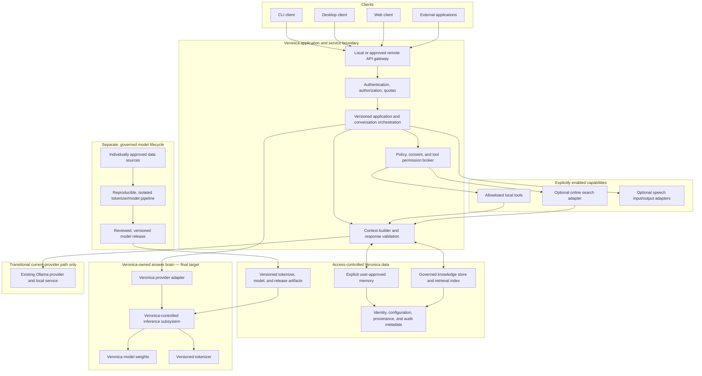

# Phase 3A: Complete Independent AI System Architecture Plan

**Status:** Planning only — no implementation or experiment is authorized.

## 1. Executive summary and long-term vision

Veronica's long-term target is an independently controlled AI ecosystem: Veronica-owned model weights, tokenizer, training pipeline, and inference subsystem; a secure backend and versioned API; governed knowledge and user-approved memory; desktop and web clients; and usable online and offline modes.

In the final native-answer mode, Veronica's own model must generate every final answer. No external AI model or AI service—including Ollama, ChatGPT, or Gemini—may generate those answers. This is a target-state requirement, not a description of today's application. The existing Ollama provider remains operational and the current provider/default until a native Veronica brain has been independently implemented, tested, and explicitly approved to replace it. No provider switch is authorized here.

The practical route is incremental and provider-neutral. Preserve the existing application/provider boundary, establish governance and acceptance criteria before any data or model work, then develop and validate components behind explicit interfaces. Established non-AI infrastructure and libraries may be evaluated; “independent” does not mean reimplementing databases, operating systems, networking, or numerical kernels. Decisions about local inference runtimes, frameworks, hosting, and storage remain open.

This plan does not authorize data acquisition, tokenizer fitting, model training, server/API implementation, or live integration. Phase 2G D-01 approves only the *objective* of a controlled tokenizer comparison; its conditions explicitly withhold experiment, fitting, training, and integration authorization. D-02 through D-18 remain pending.

English, Hindi (Devanagari), and Hinglish (Roman Hindi and code-switching) are co-equal priorities. Mixed-script text is a separate evaluation group. No aggregate score may conceal a weak result for any language.

## 2. Current architecture assessment

The following describes the inspected repository, not the proposed target.

| Area | Verified current state | Architecture implication |
|---|---|---|
| Entry points | `dev_ai.py` is the interactive CLI. `run.py` invokes the minimal `app.main` scaffold. | Keep command-line behavior as an adapter; converge future clients on a shared application/API contract rather than duplicating business logic. |
| Conversation orchestration | `AIService` assembles provider messages, uses the memory service, and coordinates provider/tool calls. | This is a useful application-layer seam, but is not a backend server, public API, identity system, or multi-user boundary. |
| Provider contract | `app/ai/base.py` defines provider-neutral request, response, capability, tool, vision, and error types. `app/ai/provider.py` registers providers and currently defaults to Ollama. | Reuse the contract where appropriate; extend only through reviewed compatibility changes. A provider-neutral interface does not itself make the answer brain independent. |
| Current answer provider | The standard-library Ollama client restricts its base URL to HTTP loopback and communicates with the locally installed Ollama service. Ollama is the only complete text-answer provider in the inspected registry. | Preserve Ollama's present operation and default status until the native replacement gates pass. Do not silently route a failed native request to another AI service in the target state. |
| Native provider | `VeronicaModelProvider` is an unavailable scaffold and advertises no usable answer-generation capability. It does not load weights or generate answers. | It is an extension point, not an existing Veronica brain. |
| Tools | `ToolRegistry` is an explicit allowlist with parameter validation and bounded execution. Search and file-name search are optional tools. | Preserve server-side allowlisting, validation, and boundedness. A model's request to use a tool must never constitute authorization. |
| Memory | SQLite stores explicitly user-approved personal memories; retrieval is simple lexical matching. | Reuse only within its present consent and local-user assumptions. It is not a document knowledge base, conversation archive, vector index, or training corpus. |
| Knowledge retrieval | No general document ingestion, provenance catalogue, knowledge database, or retrieval-augmented generation service was found. | Design it as a separate governed subsystem; keep source access, indexing, user memory, and training data distinct. |
| Tokenizer | `app/tokenizer.py` maps UTF-8 bytes directly to IDs 0–255. It is deterministic and reversible for valid UTF-8, but is not learned BPE and is not integrated into the assistant. | Retain as a baseline only. Phase 2 decisions and experiment authorization still govern any learned tokenizer work. |
| Persistence and identity | There is a local SQLite memory database. No user/account identity, tenant isolation, or general database/storage service was found. | Single-user local assumptions must not be carried into an external-client API without explicit identity, authorization, isolation, and migration design. |
| Security | `app/security` is an empty scaffold package. Tool validation exists, but there is no complete API authentication, authorization, secret-management, or deployment security layer. | Security is a prerequisite for server/API work, not a later hardening task. |
| User interfaces | A CLI exists; no desktop or web UI was found. | Future clients should be replaceable API consumers with consistent authorization and language behavior. |
| Network-dependent features | Optional Tavily web search sends a bounded query to its fixed remote endpoint and returns bounded snippets; it does not fetch result pages. Microsoft Neural TTS is online. Local Whisper STT and Piper TTS use preinstalled local assets and do not automatically download them. | Online data egress must be disclosed, minimized, configurable, and disabled in a strict offline mode. Speech components do not replace the text-answer brain. |
| Training and serving | No native text-model training pipeline, weight package, or inference engine was found. No web/API server was found. | These are major future capabilities, not small provider substitutions. |
| Dependencies/configuration | The inspected `requirements.txt` has no native language-model training or serving stack. `.env.example` contains local Ollama, memory, voice, and optional online search settings. | Do not install or select dependencies in this planning phase. Evaluate portability, licensing, security, and hardware fit before adoption. |

### Existing strengths to reuse

- Provider-neutral request and capability contracts, typed provider errors, and a provider factory.
- A separate orchestration service and explicit tool registry.
- Local-first SQLite memory with explicit user approval.
- Bounded local file-name search, optional remote web search, and explicit local speech-provider interfaces.
- A deterministic byte tokenizer that can serve as a reproducible baseline.
- Configuration through environment-backed settings and tests around current components.

### Missing capabilities and integration conflicts

- No native text brain, owned model weights, text-model training pipeline, or native inference implementation.
- No HTTP server, public API, authentication/authorization layer, account model, or remote-client isolation.
- No general knowledge ingestion/retrieval, source provenance and licensing catalogue, or access-controlled knowledge index.
- No desktop/web clients, deployment/update mechanism, API lifecycle, or defined retention and backup system.
- The current provider contract and orchestration are provider-neutral, but tool-call semantics and model capabilities can differ. The native model may not reliably follow current tool schemas without suitable model training, adaptation, and tests.
- Current CLI and single-user SQLite assumptions do not establish safe concurrency, tenant separation, external API authorization, or service availability.
- Replacing a provider changes runtime behavior, errors, latency, context limits, tool-call behavior, and potentially language quality; it cannot be treated as a configuration-only change.

## 3. Target architecture diagram

The diagram distinguishes the eventual native target from the transitional current provider. “Optional online evidence” is not an answer-generating AI provider. All final answers in the target state are generated by the Veronica brain.

In native target mode, the Ollama transition path is no longer used to generate answers. During the current stage, Ollama remains the default and operational provider. The diagram does not authorize creation of any component.

## 4. Brain and inference architecture

### Target responsibilities

1. **Tokenizer package:** a versioned tokenizer with explicit Unicode/pre-tokenization/fallback policy, vocabulary identity, compatibility metadata, and tests. The Phase 2 byte tokenizer remains a reference baseline; it is not a learned tokenizer.
2. **Model package:** Veronica-owned weights, architecture/configuration, tokenizer identity, provenance and license manifest, checksums, and documented supported precision/context limits. A checkpoint must not load against an incompatible tokenizer or configuration.
3. **Training pipeline:** separate, reproducible stages for approved data manifests, preprocessing, tokenizer/model training, evaluation, checkpoint selection, and release packaging. User conversation history, SQLite memory, credentials, logs, and personal data are excluded by default and must not become training data automatically.
4. **Inference subsystem:** load only a reviewed local release; validate compatibility; provide bounded generation, cancellation, resource limits, clear errors, and observable performance. The eventual subsystem must be under Veronica's control. The exact boundary between Veronica-maintained inference code and established local execution libraries remains a decision; no third-party service may generate final answers in the target state.
5. **Provider adapter:** translate the stable application contract to the native inference subsystem. Report actual capabilities rather than claiming unsupported streaming, tools, vision, or modalities.
6. **Response and tool policy:** treat generated text and tool requests as untrusted output. Enforce server-side policy, tool scopes, confirmations, schema limits, and safe rendering before any action or presentation.

### Transition and replacement gates

- Keep the present provider registry/default and Ollama operation unchanged until a separate release decision.
- Build and test a native provider behind the existing provider boundary only after the required model, tokenizer, runtime, privacy, and implementation approvals.
- Validate the new provider independently for supported languages, mixed-script input, tool behavior, context/resource limits, deterministic configuration, offline behavior, and failure handling.
- Compare against documented acceptance criteria approved in advance; report English, Hindi, Hinglish, and mixed-script results separately.
- Run controlled integration testing without changing the user-visible default. Do not use silent traffic duplication that sends private prompts to another service.
- Require explicit approval for replacement. Keep rollback and a documented Ollama transition path until release acceptance. Do not silently fall back to external AI in a mode represented as native-only.

The project has not selected a model architecture, parameter count, training objective, inference runtime, precision, context length, or quality threshold. A small model is not presumed capable of broad assistant tasks.

## 5. Backend and server architecture

The future backend should be the single application boundary used by CLI, desktop, web, and authorized external applications.

- **Lifecycle:** explicit configuration validation, model/provider readiness checks, graceful startup/shutdown, bounded request queues, health/readiness endpoints, and actionable error reporting.
- **Request handling:** validate sizes and schemas before work; apply authentication, per-client policy, quotas, timeouts, cancellation, and concurrency controls. Avoid unbounded prompt, response, image, audio, or tool payloads.
- **Application services:** keep conversation orchestration, context construction, memory, knowledge retrieval, tool execution, and answer-provider calls in separable services. Do not let HTTP handlers directly access databases or execute tools.
- **Inference isolation:** begin with the simplest deployment that can safely meet measured resource and fault-isolation needs. Evaluate a separate local inference worker/process if model loading, GPU memory, cancellation, or crash containment warrants it. This is an option, not a selected topology.
- **State:** distinguish transient request/session state from durable user-approved memory, knowledge content/index, account/configuration metadata, audit records, and model artifacts.
- **Operations:** expose health and resource status without leaking prompts, secrets, or personal data. Provide bounded diagnostics and a documented offline startup path.
- **Failure behavior:** fail visibly when the configured brain is unavailable. Do not mask failures with an unapproved provider fallback or success-shaped response.

## 6. Public API architecture

“Public API” means a documented interface for external applications; it does not imply unauthenticated exposure to the public internet. Whether deployment is loopback-only, LAN-accessible, or internet-facing must be decided separately.

Proposed contract characteristics, not implementation choices:

- Versioned, language-neutral request/response schemas and a generated or maintained API specification.
- Explicit endpoints for health/readiness, capabilities/model metadata, conversation, user-approved memory, and—if approved—knowledge operations. Each endpoint receives a least-privilege scope.
- Stable error types, request IDs, timeout/cancellation behavior, pagination and payload limits. Streaming transport is optional and undecided.
- Per-client credentials or another approved identity mechanism; revocation, rotation, quotas, and audit metadata.
- For browser clients: restrictive origins, secure session/CSRF strategy, content security policy, and protection against local-network request abuse. Loopback binding alone is not authentication.
- For remote access: authenticated transport encryption, deployment hardening, abuse controls, and a separate approval gate. Do not expose the current local service by changing a bind address alone.
- No endpoint may accept arbitrary shell commands, unrestricted paths, SQL, or unbounded model/tool instructions.
- Do not place API keys or secrets in prompts, client-visible responses, or ordinary logs.

The repository currently contains no API/server implementation or API authentication system. REST, RPC, streaming, API gateway, and identity-provider selections remain pending.

## 7. Knowledge system architecture

Knowledge retrieval is distinct from model weights and personal memory.

1. **Source approval:** record source owner, rights/license, purpose, scope, provenance, privacy review, retention, update and deletion rules before ingestion.
2. **Controlled ingestion:** process only explicitly approved sources; use bounded, isolated parsers; retain source identifiers, timestamps, version/hash, and access policy; provide deletion and re-indexing procedures.
3. **Separate stores:** keep original approved files, parsed text, index, and provenance metadata distinguishable. Apply user/tenant access checks at retrieval time, not merely at ingestion.
4. **Retrieval:** start from a measurable, explainable baseline. Lexical retrieval is an option compatible with existing Python/SQLite practice; semantic/vector retrieval and embedding-model choices are undecided. Any component that generates text must meet the independent-brain policy if its text could be presented as Veronica's final answer.
5. **Answer grounding:** pass bounded, attributed evidence to the Veronica answer brain. Preserve source/citation references and distinguish retrieved claims from model inference. Retrieval does not guarantee factual correctness.
6. **Online evidence:** web search can be an optional, disclosed tool with strict query minimization and bounded results. The existing Tavily adapter is a search interface, not a general crawler or knowledge ingestion pipeline. Remote content is untrusted and may contain prompt injection.

Private conversations, chat history, SQLite memory, credentials, logs, and personal data remain excluded from knowledge/training ingestion by default. Per-source approval and authorization are required for any exception.

## 8. Memory system architecture

Memory is a user-controlled personalization feature, not a transcript archive or training data source.

- Separate ephemeral conversation context from durable memory and from knowledge documents.
- Preserve explicit consent, inspect/edit/delete controls, clear retention settings, and a visible explanation of what is stored and why.
- Partition memory by authenticated user and application/client scope once multiple identities exist. Never infer identity from a prompt or client-supplied user ID alone.
- Apply access checks before retrieval; prevent cross-user leakage; make backup, export, deletion, and database migration behavior explicit.
- Store only minimal, user-approved facts. Exclude credentials, sensitive personal data, and inferred traits unless a future policy explicitly permits them.
- Avoid automatic transcript-to-memory writes and prohibit automatic memory-to-training flows.
- Keep current SQLite memory behavior unchanged until a separate implementation and migration approval.

The current system is a local, personal-memory implementation with lexical retrieval. It does not provide multi-user access control, memory lifecycle APIs, or training governance.

## 9. Database and storage architecture

No final database or storage technology is selected.

| Data class | Proposed boundary | Key requirements |
|---|---|---|
| User/account and service metadata | Structured metadata store | Identity linkage, least privilege, migrations, integrity, and backup/restore. |
| Explicit personal memory | Existing SQLite component may be reused for a local single-user stage | Consent, minimal retention, user-visible deletion, protected local files, and no training reuse. |
| Knowledge sources/index | Separate source files, provenance catalogue, and retrieval index | Rights/provenance, access control, freshness, re-index/deletion, and tenant separation. |
| Sessions and transient context | Prefer bounded, configurable retention; avoid persistence unless needed and approved | No default transcript archive; redaction, expiry, and export/deletion policy. |
| Model/tokenizer/release artifacts | Versioned local artifact directory or managed artifact store | Checksums, compatibility manifests, rollback, access controls, disk budgeting, and no automatic downloads. |
| Audit/security events | Minimal structured records | Record security-relevant actions without storing prompt contents or secrets by default; define retention and access. |
| Backups | Separate protected and tested recovery path | Encryption and key custody, scope/retention, restore drills, and deletion propagation. |

SQLite may suit an offline, single-user deployment. A multi-user or concurrent service could require a different relational store; this must be decided using expected concurrency, consistency, operations, and threat model. A vector database is not assumed. Database encryption, key management, backup location, migrations, retention, and user-data portability remain open decisions.

## 10. Desktop and web interface architecture

No desktop or web interface currently exists. The future clients should call the same application/API contracts rather than implement separate answer logic.

- **CLI:** retain as a compact diagnostic and accessible automation client.
- **Desktop:** may provide local model/runtime status, privacy and online-mode indicators, explicit memory controls, tool consent, and accessibility/localization. Packaging and framework are undecided.
- **Web:** may be local or remote. A local web UI still needs browser-origin protections, authentication, session/CSRF controls, secure local binding, and safe handling of untrusted retrieved/generated content.
- **External apps:** use the versioned API with individually scoped, revocable client credentials and quotas.
- **Language parity:** UI labels, input/output paths, and error states should work for English, Hindi, and Hinglish without assigning language priority. Mixed-script cases should have their own acceptance tests.
- **Offline mode:** disclose model and knowledge availability; do not imply that optional remote search or online speech is available.

Client frameworks, packaging, update channel, localization approach, and device synchronization are unapproved.

## 11. Security and privacy architecture

Security is a cross-cutting prerequisite for API exposure, multi-user memory, tools, online retrieval, and model artifact handling.

### Trust boundaries and threats

- Unauthenticated or overprivileged local/remote API clients; browser-origin abuse; credential theft; brute force and resource exhaustion.
- Prompt injection in user input, retrieved documents, or search snippets; unsafe tool arguments; confused-deputy behavior.
- Cross-user leakage through memory, knowledge retrieval, logs, caches, or shared model context.
- Malicious or malformed documents, model/tokenizer artifacts, dependency compromise, parser exploits, and data poisoning.
- Secret/personal-data disclosure through prompts, telemetry, exception text, backups, or online search/TTS.
- GPU/CPU/memory/disk exhaustion, stuck inference, and unsafe failure/fallback behavior.

### Required controls before service release

- A documented threat model, data-flow inventory, and privacy review for each deployment mode.
- Authentication and server-side authorization for every API operation; least privilege, per-client scopes, revocation, and tenant isolation where applicable.
- Strict request/tool schemas, allowlists, bounded execution, safe path handling, and explicit confirmation for consequential actions. Model output never grants its own permissions.
- Treat prompts and retrieved content as untrusted data. Separate instructions from evidence, preserve source metadata, and do not provide secrets to the model.
- Egress policy: offline mode blocks network access; online actions are explicit, visible, minimized, and tested. Protect credentials with an approved secret store and never log them.
- Hardened artifact/dependency process: provenance, license review, hashes/signatures where feasible, pinned reviewed dependencies, and controlled updates.
- Data minimization, encryption-at-rest/in-transit as appropriate, retention/deletion controls, secure backups, and access-limited/redacted audit records.
- Rate/resource limits, timeouts, cancellation, safe rendering, security testing, incident response, and documented recovery.

The current tool registry's validation is a useful control, not a substitute for identity, authorization, network security, or a full threat model. The Phase 1J audit also records limited code-level follow-up findings; those findings should be resolved or explicitly accepted before broadening trust boundaries. This plan does not alter them.

## 12. Online and offline architecture

| Capability | Offline target | Online behavior and boundary |
|---|---|---|
| Text answers | Veronica-owned local model, tokenizer, inference subsystem, and approved local context | The final answer still comes from Veronica. No external AI answer provider is allowed in native target mode. |
| Memory and local knowledge | Local protected stores and indexes | Sync or remote storage is not assumed; any later sync needs separate privacy and conflict-resolution approval. |
| Local tools | Only explicitly configured, allowlisted capabilities | Network-capable tools require separate scopes, disclosure, and egress policy. |
| Web search | Unavailable or clearly reported unavailable | Optional search sends only an approved/minimized query to a selected provider; retrieved content is untrusted evidence. |
| Speech input/output | Preinstalled local speech models and local audio hardware, if available | Online speech is a distinct capability; text/audio egress must be disclosed and opt-in. |
| Updates/artifacts | Manually provisioned and verified local packages | No automatic model, tokenizer, dataset, or dependency downloads by default. |

The present Ollama adapter is local loopback; optional Tavily web search and Microsoft Neural TTS use network services. Local Whisper and Piper paths expect preinstalled assets. A future offline mode must be enforced at the service/network boundary, not represented by a UI toggle alone. Test that offline operation makes no unintended outbound connections.

## 13. Component dependencies and integration flow

### Request flow in the target state

1. A client submits a bounded request to the API/application boundary.
2. The service authenticates the client and authorizes the operation and data scope.
3. The application assembles transient context and retrieves only accessible, user-approved memory and knowledge.
4. Policy checks decide whether any requested tool is allowed; consequential actions require appropriate authorization/confirmation.
5. The provider adapter invokes the configured brain. In final native mode this must be Veronica's local inference subsystem and matching model/tokenizer package.
6. The answer brain generates the final answer. Optional retrieval/tool evidence may inform it but does not replace it.
7. Response validation, safe rendering, and approved optional speech output occur before delivery.
8. Only explicitly configured metadata/audit information is persisted; conversation content is not retained by default.

### Separate model lifecycle

Approved data sources → documented provenance/rights manifest → isolated and reproducible tokenizer/model pipeline → separately evaluated release candidate → signed/versioned compatible artifacts → explicit deployment approval.

This lifecycle must never implicitly consume conversation logs or the personal-memory database. Retrieval content and training data require separate approval and storage.

### Dependency order

- API, desktop/web, and external applications depend on a stable application contract and security model.
- Native provider integration depends on a working model/tokenizer package, inference subsystem, truthful capability contract, and acceptance tests.
- Training depends on approved purpose, sources/rights/privacy, language-balanced evaluation, compute budget, reproducible tooling, and separate authorization.
- Knowledge retrieval depends on source governance, provenance, access control, and deletion behavior.
- Multi-user memory depends on identity, authorization, isolation tests, and a data-migration/retention plan.
- Online/offline guarantees depend on explicit egress policy and deployment-level network controls.

## 14. Development roadmap and milestones

Every item below is a proposed future stage, not present authorization. Each stage requires its own approved scope and exit review.

| Stage | Objective | Dependencies and exit gate |
|---|---|---|
| 0. Architecture and product decisions | Decide deployment audiences, target ownership definition, privacy model, operating modes, API exposure, and acceptance approach. | User decisions and documented threat/data-flow model; no implementation implied. |
| 1. Governance and experiment prerequisites | Resolve applicable Phase 2 decisions, source/license/privacy requirements, evaluation design, reproducibility, and resource limits. | Phase 2G D-01 is objective-only; D-02–D-18 remain pending. A separate explicit experiment authorization is required before any tokenizer experiment. |
| 2. Bounded tokenizer comparison | If separately authorized, compare candidates against the byte baseline with approved synthetic/approved data and language-separated reports. | Source-specific approvals, method/tool choices, evaluation gates, compute limits, and explicit experiment authorization. No training of a language model is included. |
| 3. Model research and training pipeline | Design and, only after separate authorization, implement a reproducible path to Veronica-owned weights. | Model/data decisions, rights and privacy approvals, architecture/compute feasibility, evaluation plan, and a separate model-training authorization. |
| 4. Native inference subsystem | Build/qualify a Veronica-controlled local execution path for a compatible, approved release. | Approved runtime/ownership definition, supported hardware, packaging, security, offline and resource tests. No provider switch follows automatically. |
| 5. Native provider integration | Integrate the native adapter behind the provider contract and test in a non-default configuration. | Independently tested model, provider conformance, failure/rollback plan, language acceptance, and separate integration authorization. Ollama stays operational/current until replacement approval. |
| 6. Governed knowledge and memory services | Evolve local memory and add source-governed retrieval with clear separation from training data. | Identity/access model, source approvals, retention/deletion, provenance, threat review, migration and isolation tests. |
| 7. Backend and API | Implement a shared service contract for clients and approved external applications. | Security architecture, authentication/authorization, transport/deployment decision, operational controls, and separate server/API authorization. |
| 8. Desktop and web clients | Add clients on the approved API, with privacy/online state and memory/tool controls. | API stability, UX and accessibility decisions, client threat review, and localization acceptance. |
| 9. Release and operational readiness | Package, monitor, back up, recover, update, and support native/offline operation. | End-to-end security, language, offline/egress, load, recovery, migration and user acceptance; explicit release and provider-replacement approvals. |

Some design work can proceed in parallel, but implementation dependencies and authorization gates cannot be skipped or inferred from this roadmap.

## 15. Testing and acceptance criteria

No thresholds or measured results are set by this plan. Product owners must approve measurable thresholds before evaluation; a passing aggregate must never hide a weak language subgroup.

- **Provider contract:** request/response schemas, capability reporting, model-unavailable/timeout errors, cancellation, tool-call validation, and compatibility with orchestration.
- **Language behavior:** separate English, Hindi (Devanagari), Hinglish (Roman Hindi/code-switching), and mixed-script test reports. Evaluate task quality, safety, instruction following, Unicode correctness, and regressions independently.
- **Tokenizer/model compatibility:** exact artifact identity, round trips/fallback as specified, malformed-input handling, context truncation, and reproducible loading.
- **Knowledge:** source attribution, freshness, access-control isolation, deletion/re-index behavior, prompt-injection resilience, and answer grounding. Do not invent evidence or report unmeasured quality.
- **Memory/privacy:** consent, access, edit/delete, expiry, export/backup, tenant isolation, and proof that memory/chat logs do not flow into training automatically.
- **Tools/API security:** authentication/authorization, scopes, schema/payload boundaries, path/command restrictions, confirmation, rate limits, CSRF/origin handling, and audit redaction.
- **Online/offline:** network-egress tests, disclosed remote destinations, offline startup and local answer generation, no automatic downloads, and correct unavailable states for remote-only features.
- **Reliability:** startup checks, malformed artifact handling, timeouts, cancellation, queue saturation, process crash/recovery, backup restore, and rollback.
- **Performance and hardware:** measure cold/warm load, first-token/total latency, throughput, memory/VRAM, thermal behavior, and concurrent requests on declared target hardware. Set acceptance limits only after measurement and approval.
- **Migration:** verify the current Ollama path remains operational through development; test native integration without changing default; require explicit replacement and rollback approval.
- **Client usability:** accessibility, safe display of untrusted content, language parity, error clarity, and consistent consent/online-state indicators.

The existing test suite was not run for this documentation-only phase. Historical test results in earlier reports are not evidence of current native-model, API, security, or hardware acceptance.

## 16. Hardware feasibility and limitations

Phase 1E records a Windows 11 laptop with Intel Core i5-13420H, 16 GB system RAM, and an NVIDIA RTX 3050 Laptop GPU with 6,144 MiB reported VRAM; its inspection snapshot reported 2.81 GiB available RAM and 281.95 GiB free disk. It also recorded Python 3.14.5, driver 576.93, and driver-reported CUDA 12.9.

These are historical environment observations, not a current capacity guarantee or a successful framework/GPU validation. CUDA Toolkit/framework GPU operation, sustained throughput, thermals, memory headroom under the full application, and actual training/inference performance remain unverified. Phase 1F's parameter budgets are planning estimates, not model selections or capability guarantees. The current dependency manifest does not supply a text-model training/inference stack.

The available machine is a constrained development environment. It may support small, carefully bounded research only if later approved and measured; it does not establish feasibility for a competitive general-purpose multilingual assistant or production-scale training. No model size, hardware purchase, cloud use, package installation, or training job is approved here. Reassess with repeatable measurements and consider the data privacy and cost implications before relying on remote compute.

## 17. Risks, unresolved decisions, and approval gates

### Principal risks

- **Capability gap:** a tokenizer prototype and provider scaffold do not constitute a useful answer brain; owning capable multilingual weights requires substantial approved data, compute, evaluation, and engineering.
- **Language imbalance:** pooled metrics or majority-language data can hide poor Hindi, Hinglish, or mixed-script behavior.
- **Data-rights/privacy:** ambiguous provenance, licenses, consent, retention, or personal-data exposure can invalidate an otherwise useful corpus or service.
- **Runtime/compatibility:** model and tokenizer version mismatch, insufficient context/resource budgets, incompatible tool behavior, or unvalidated acceleration can make a native provider unusable.
- **Provider migration:** switching too early may break quality, reliability, tool use, latency, or the user's existing workflow; hidden fallback would violate the native-only target.
- **API threat surface:** exposing a local prototype to external clients without identity, isolation, and egress controls can expose memory, files, tools, or credentials.
- **Retrieval/tool injection:** external documents and model output are untrusted; policy must remain outside the model.
- **Operational complexity:** backup, deletion, updates, model storage, GPU contention, deployment, and incident response are not present today.
- **Scope creep:** completing an architecture plan is not authorization for its roadmap, tokenizer experiments, training, or implementation.

### Decisions still open

- Definition of Veronica's ownership boundary for model, tokenizer, training pipeline, and inference engine; permissible local runtime/library relationship.
- Intended user/deployment model: local single-user, LAN, hosted multi-user, or more than one; external API exposure and identity model.
- Model architecture/objective, tokenizer choices and size, Unicode policy, pre-tokenization, fallback, training data, and separately approved evaluation thresholds.
- Source-by-source rights, privacy, provenance, acquisition, retention, and exclusion policies.
- Compute/resource budget, training location, performance targets, model precision/context length, and supported hardware.
- Knowledge source types, parser/index/retrieval approach, embedding policy, citations, freshness, tenant controls, and deletion.
- Memory scope, retention, export/deletion, multi-user partitioning, and backup/key management.
- API transport/versioning/streaming, framework, deployment topology, desktop/web frameworks, packaging and update mechanism.
- Authentication, authorization, secret storage, audit retention, network egress, online feature consent, and incident response.
- Rollout, acceptance, migration/rollback, and criteria/date for any provider replacement.

### Approval status from prior phases

- Phase 2A established the independent deterministic byte-level tokenizer prototype; it is not a learned tokenizer and is not integrated.
- Phase 2B–2F are validation/design/governance/readiness/recommendation documents, not experiment results or approvals.
- The actual Phase 2D file is `PHASE_2D_DATASET_GOVERNANCE_AND_EXPERIMENT_AUTHORIZATION_PLAN.md`; an earlier filename discrepancy was reconciled in Phase 2G.
- Phase 2G records D-01 as **APPROVED only for the controlled-comparison objective** (byte baseline; BPE, Unigram, WordPiece candidates; English/Hindi/Hinglish co-equal; mixed-script separate). The same record explicitly disallows dataset acquisition, tokenizer fitting or experiments, model training, and provider/inference integration.
- Phase 2G records D-02 through D-18 as **PENDING USER DECISION**. The overall tokenizer experiment authorization gate remains **NOT AUTHORIZED**.
- Phase 1's separate data/model-operation approvals remain governed by their own records; the later Phase 2G objective approval does not grant training or data authorization.

No recommendation in this architecture is user approval. Before an applicable future activity, obtain the specific user decisions, legal/privacy/specialist review where required, source-specific evidence, bounded scope, tests, and separate explicit authorization. A blank or incomplete gate means **NOT AUTHORIZED**.

## 18. Explicit exclusions and authorization boundaries

This document authorizes only read-only architecture planning. It does **not** authorize:

- Dataset discovery/acquisition, corpus access or processing, scraping, or use of private conversations, SQLite memory, credentials, logs, or personal data.
- Tokenizer fitting, vocabulary creation, candidate comparison runs, or any other tokenizer experiment.
- Model training, fine-tuning, checkpoint/model creation, or inference-engine implementation.
- Package/dependency installation, model downloads, API/server work, database migrations, or source/test/configuration changes.
- Provider-default changes, removal of Ollama, native-provider integration, or changes to inference behavior.
- Knowledge ingestion, automatic memory processing/training, online egress changes, or deployment/exposure to external clients.
- Commit, push, publication, or release.

Every listed activity requires its own scope and applicable approvals. D-01 is an approved objective only and cannot be interpreted as any of those authorizations.

## Final verdict

**PLANNING-READY; NOT IMPLEMENTATION-READY; NOT AUTHORIZED FOR A TOKENIZER EXPERIMENT, DATA ACQUISITION, MODEL TRAINING, API/SERVER WORK, OR PROVIDER REPLACEMENT.**

The architecture direction is sufficiently concrete to organize future decisions and gates. It is not evidence that the hardware, data rights, model capability, security design, or implementation is ready. Ollama remains the current operational provider until a native Veronica brain is independently implemented, tested, and explicitly approved for replacement. The eventual native answer path must generate final answers with Veronica's own brain, with English, Hindi, and Hinglish co-equal and mixed-script separately evaluated.

## Inspection record

The following repository files and relevant Phase 1/2 material were inspected for this plan. This inventory records inspection scope; it does not imply that every historical statement in those documents remains current or that tests were rerun.

### Project files

- `README.md`, `requirements.txt`, `.env.example`, `.gitignore`
- `run.py`, `dev_ai.py`
- `app/main.py`, `app/config.py`, `app/tokenizer.py`
- `app/ai/__init__.py`, `app/ai/base.py`, `app/ai/provider.py`, `app/ai/service.py`, `app/ai/veronica_provider.py`, `app/ai/tool_calling.py`, `app/ai/ollama_client.py`
- `app/memory/database.py`, `app/memory/models.py`, `app/memory/service.py`
- `app/tools/base.py`, `app/tools/registry.py`, `app/tools/web_search.py`, `app/tools/file_search.py`
- `app/voice/base.py`, `app/voice/stt.py`, `app/voice/tts.py`, `app/voice/microsoft_tts.py`
- `app/security/__init__.py`, `app/services/__init__.py`

### Phase documents

- Phase 1A provider architecture; Phase 1B native AI foundation; Phase 1C data/evaluation foundation; Phase 1D decisions and approval matrix.
- Phase 1E technical feasibility; Phase 1F model architecture/parameter budget; Phase 1G pre-implementation readiness; relevant Phase 1H/1I status and findings; Phase 1J implementation report and independent final audit.
- Phase 2A native tokenizer implementation report and independent code audit; Phase 2B tokenizer testing/multilingual validation; Phase 2C learned-tokenizer design/vocabulary plan.
- Phase 2D dataset governance and experiment authorization plan; Phase 2E tokenizer readiness/decision closure plan; Phase 2F decision review/recommendation matrix; Phase 2G user decision workshop and approval record.

Phase 2D's existing filename is `docs/PHASE_2D_DATASET_GOVERNANCE_AND_EXPERIMENT_AUTHORIZATION_PLAN.md`. No Phase 2D document was recreated or modified for this architecture plan.
